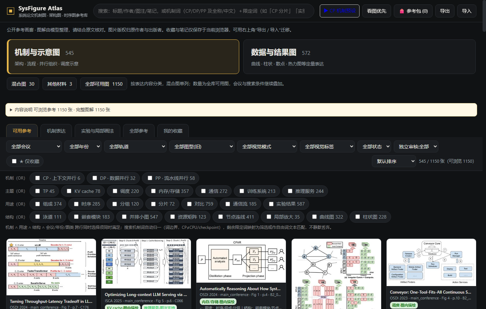

# SysFigure Atlas

**Find how systems papers explain ideas.**

**系统论文参考画廊：找图、读懂画法、并排比较。**

[**Explore the gallery →**](https://cookiesheep.github.io/sysfigure-atlas/) · [中文介绍](#中文介绍) · [Suggest a paper](https://github.com/cookiesheep/sysfigure-atlas/issues/new?template=paper-suggestion.md) · [Report a correction](https://github.com/cookiesheep/sysfigure-atlas/issues/new?template=figure-correction.md)

**1,150 figures · 209 papers · source-linked explanations · no account required**

[](https://cookiesheep.github.io/sysfigure-atlas/)

Designing a systems-paper figure often starts with a question: *How have other authors made this mechanism understandable?* SysFigure Atlas helps you explore those examples, inspect their elements and reading order, and save useful references for your own work.

The current interface and detailed explanations are primarily **Chinese**; paper titles, source captions, and many technical terms remain in English. This repository contains the runnable static gallery and its published content.

## Try it in one minute

| You want to explore… | Start here |
| --- | --- |
| How context parallelism is depicted | [CP diagrams](https://cookiesheep.github.io/sysfigure-atlas/?q=CP&fig_type=structural) |
| Parallelization choices and device mappings | [Alpa examples](https://cookiesheep.github.io/sysfigure-atlas/?q=Alpa&fig_type=structural) |
| Loading and migration in LLM serving | [ServerlessLLM examples](https://cookiesheep.github.io/sysfigure-atlas/?q=ServerlessLLM&fig_type=structural) |
| Quantitative presentation styles | [Data and result plots](https://cookiesheep.github.io/sysfigure-atlas/?fig_type=quantitative) |

Open a figure, read **what it shows → what its elements mean → how to read it**, then add two to four figures to the comparison view. Save the useful ones and note what you would borrow.

## What you can do

- **Browse diagrams and quantitative plots separately.** Architecture, mechanism, and process figures have their own entry point; charts and experimental results have another. Mixed figures are labeled separately.
- **Find a mechanism or an expression pattern.** Filter by CP / DP / PP, topics such as KV cache and scheduling, purposes such as comparison and partitioning, and structures such as swimlanes, resource matrices, and nested modules.
- **Understand the reference.** Each published figure has a six-part explanation covering meaning, elements, reading order, visual encoding, reusable ideas, and limits of interpretation. Source captions and paper links remain available.
- **Compare and follow related examples.** View 2–4 figures side by side, or use “找同类画法” to discover candidates sharing purpose and structure tags. Relatedness is based on **tag overlap**, not an image-similarity model.
- **Keep a personal reference shelf.** Favorites, notes, and collections stay in your browser. Export/import lets you move them between browsers or between the local and hosted gallery.

Search combines mechanism aliases with remaining query terms. For example, `CP` means *context parallelism* in the mechanism search; a matching acronym in a paper title alone does not establish that the figure depicts CP.

## Collection snapshot

| Published figure category | Count |
| --- | ---: |
| Structure and mechanism diagrams | 545 |
| Quantitative plots | 572 |
| Mixed diagrams and plots | 30 |
| Other reference material | 3 |
| **Total** | **1,150** |

The collection includes papers from OSDI, SOSP, NSDI, MLSys, FAST, ASPLOS, EuroSys, SIGCOMM, SC, and other venues, plus identified preprints. These counts describe the published snapshot, **not complete coverage of those venues**. Publication identity and the PDF version used for a figure are tracked separately.

## Quality and interpretation

Figures and explanations have gone through model-assisted visual review; errors in tags, captions, interpretation, or cropping can remain. Please check the source paper before using a scientific claim. A useful visual reference is not evidence that the same mechanism or performance result applies to your system.

Spot a wrong arrow interpretation, missing label, or misleading tag? [Send a correction](https://github.com/cookiesheep/sysfigure-atlas/issues/new?template=figure-correction.md) with the figure ID and the relevant source evidence. Specific examples help more than a general quality score.

## Run locally

The hosted gallery needs no installation. To run this published snapshot locally:

```bash
git clone --depth 1 https://github.com/cookiesheep/sysfigure-atlas.git
cd sysfigure-atlas
python -m http.server 8000 --bind 127.0.0.1
```

Open **http://127.0.0.1:8000/**. The static release is roughly 536 MiB, mostly figure crops and source-page previews; the clone downloads those assets. No API key or backend service is needed. Use an HTTP server rather than opening `index.html` with `file://`.

```text
index.html / app.js / style.css   Static gallery UI
refpack_guard.js                 Reference-pack eligibility checks
data/index.json                 Figure identities, sources, and asset paths
data/gallery_content.json       Tags and figure explanations
assets/                         Crops, thumbnails, and source-page previews
```

The local paper-collection, review, and MCP tooling is not included in this public release. This repository is usable on its own as a gallery. Browser preferences do not sync automatically across devices or sites.

## Contribute and collaborate

See [CONTRIBUTING.md](CONTRIBUTING.md) for small, useful contributions:

- Correct one explanation, tag, caption, or crop with source evidence.
- Suggest a missing systems paper **and a specific figure worth studying**.
- Report a real search that failed, including the result you expected.
- Discuss a curated systems collection or an adapter for another figure gallery.

If the gallery helps your research, **a GitHub star helps other researchers discover it**. Sharing a specific useful example with your lab is welcome too.

## Acknowledgments and reuse

The browsing idea was inspired by [Top-Conf Figure Gallery](https://github.com/qwdwqfwq/topconf-paper-figure-gallery). SysFigure Atlas focuses on systems-paper references and explanations of their visual structure. We welcome discussion about connecting the collections or contributing a systems-focused module.

Paper figures belong to their original authors and publishers. Source links are retained; this repository does not grant a new license to third-party figures. Check the source terms before reuse or redistribution. For attribution corrections or removal requests, [open an issue](https://github.com/cookiesheep/sysfigure-atlas/issues).

---

## 中文介绍

**想画一张系统论文图，先找到别人如何把类似的关系讲清楚。**

SysFigure Atlas 目前提供 **1,150 张参考图，来自 209 篇论文**，每张都有六段图解。你可以先分开浏览「机制与示意图」和「数据与结果图」，再按会议、年份、机制、主题、表达用途和视觉结构筛选。

例如，搜 **CP** 看上下文并行的表达；搜 **Alpa** 看并行方案与设备映射；搜 **ServerlessLLM** 看装载与迁移。点开后先读“这幅图讲什么”和“图里元素是什么”，再把 2–4 张图加入对比，收藏并记下想借鉴的画法。

**当前能力：** 浏览、找图、图解、同类画法、对比、收藏和笔记。自动生成论文图目前不在公开版本中。同类候选来自标签共现；图解是模型辅助整理，仍可能有误，论文中的科学结论应回到原文核对。

不需要登录、API key 或安装软件。[打开在线画廊](https://cookiesheep.github.io/sysfigure-atlas/) 即可使用。收藏与笔记只存在当前浏览器，可通过右上角「导出 / 导入」迁移。

欢迎带着**具体图 ID、原文证据或真实找图需求**提 issue。若它帮你找到了有用的参考，欢迎 star，或者分享给正在画论文图的同学。
